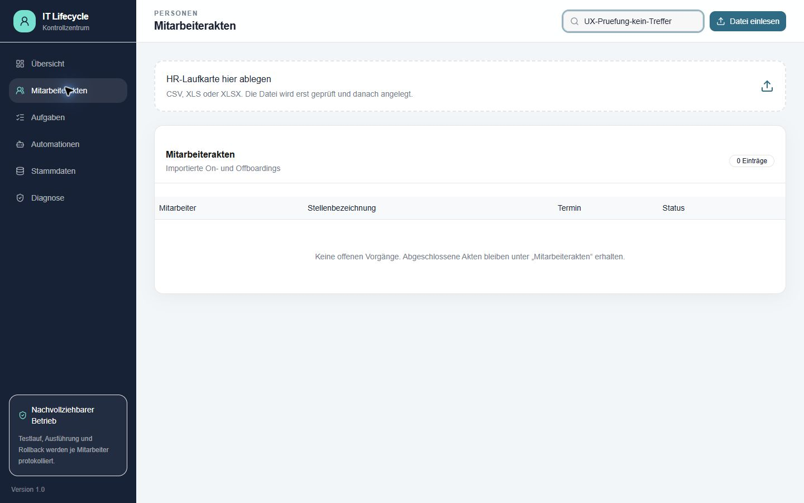
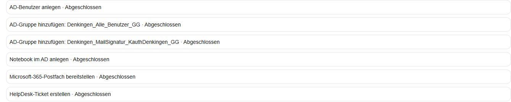
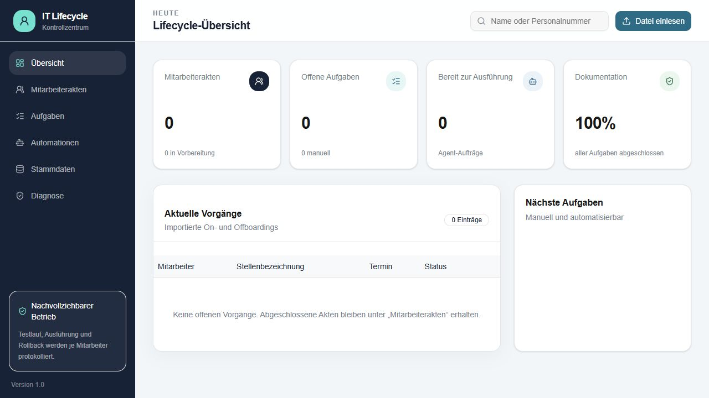
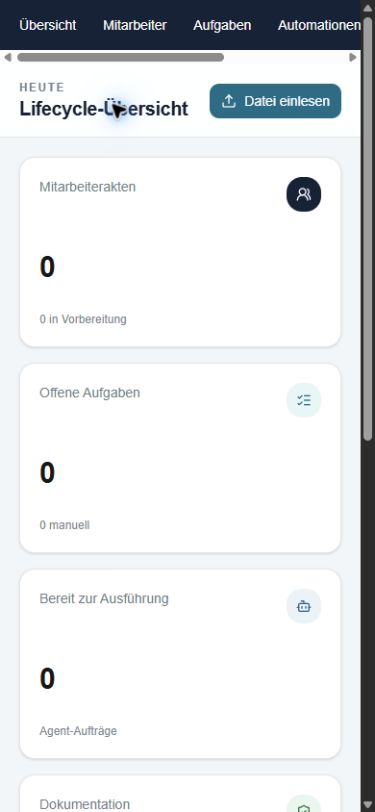

# Unabhängiges UI/UX-Audit – Kauth IT Lifecycle

Prüfdatum: 5. Oktober 2026. Grundlage: interaktive Bedienung der sichtbaren Website in Chrome. Die Prüfung wurde nach dem Browserwechsel vollständig neu begonnen. Kein Zugriff auf Quellcode, Repository, Projektdateien, Datenbank, Serverlogs, frühere Auditberichte, direkte APIs oder JavaScript-Bundles. Es wurden keine Daten gespeichert, Aufgaben geändert oder Aufträge gestartet. Die bereitgestellten Zugangsdaten mussten im vorhandenen Browser nicht eingegeben werden.

Personen werden als **Akte A** und **Akte B** bezeichnet. Akte A ist der sichtbar als Test bezeichnete Eintrag mit kurzem erfolgreichen Verlauf; Akte B ist der andere abgeschlossene Eintrag mit langem Verlauf. Namen, Personalnummern, Benutzerkennungen, Dateinamen mit Personennamen und freigegebene Linktoken werden nicht wiedergegeben. Screenshotbelege enthalten nur personenbezogen freie Ansichten oder entsprechend begrenzte Ausschnitte.

## Gesamturteil

Die Anwendung hat eine verständliche Grundnavigation und eine brauchbare Trennung von Ausstattung, Aufgaben, Automation und Historie. Ein abgeschlossener Vorgang ist über Mitarbeiterakten schnell auffindbar. Die wichtigste Schwäche ist die Bedeutung der Zustände: Ein Nutzer kann aus den vorhandenen Anzeigen nicht zuverlässig ableiten, was tatsächlich vorhanden ist und ob ein Fehler noch Handlungsbedarf bedeutet.

Die drei größten Hindernisse:

1. **Abschluss, Bestand und Automation ergeben kein eindeutiges Gesamtbild.** In Akte B sind alle Aufgaben erledigt und der Vorgang abgeschlossen, während Ausstattung weiter beantragt ist und die letzte Automation fehlgeschlagen ist. Eine erklärende Zusammenfassung fehlt. Die öffentliche Ansicht nennt beantragte Einträge sogar „bereitgestellt“.
2. **Die Freigabe beschreibt die Auswirkungen unvollständig.** Die Vorschau enthält Microsoft-365-Aktionen, der letzte Bestätigungsdialog erwähnt nur AD und HelpDesk und nennt den ausgewählten Mitarbeiter nicht. Die Rollback-Ansicht ist technisch und erläutert ausgelassene Änderungen nicht vollständig.
3. **Der tägliche Arbeitsweg verlangt unnötige Suche und Scrollen.** Die Seite Automationen ist vor allem eine Planungssicht; Ergebnisse liegen in der Akte hinter einer langen Vorschau. Aufgaben zeigen sämtliche erledigten Einträge ohne sichtbaren Statusfilter. Aktenzeilen sind zudem nicht per Tabulator erreichbar.

Als neuer Mitarbeiter kann man die Bereiche verstehen, muss aber die Statuslogik selbst rekonstruieren. Ein erfahrener Nutzer findet Details, verliert jedoch Zeit durch lange Verläufe und den Wechsel zwischen Planung und Akte. Diese Bewertung betrifft die beobachteten Oberflächen; sie bestätigt weder Datenqualität noch den tatsächlichen Zustand externer Systeme.

## Priorisierte Befunde

„Kritisch“ bezeichnet hier ein hohes Risiko einer falsch verstandenen Freigabe. „Wesentlich“ beeinträchtigt Verständnis, Arbeitseffizienz oder Zugänglichkeit deutlich. „Kosmetisch“ betrifft kleinere sprachliche oder visuelle Unstimmigkeiten. Alle folgenden Beobachtungen wurden an der Website festgestellt; Nutzerfolgen sind daraus abgeleitete Risiken, keine nachgewiesenen Fehlbedienungen.

### K1 – Ausführungsfreigabe nennt nicht alle Auswirkungen

- **Seite/Zustand:** Automationen, Akte B ausgewählt, Bestätigungsdialog.
- **Bedienweg:** Automationen → Akte B auswählen → Ausführungsvorschau lesen → „Echt ausführen“ → Dialog lesen → Abbrechen bzw. Escape. „Ausführung starten“ wurde nicht betätigt.
- **Beobachtung:** Die Vorschau umfasst neun Aktionen einschließlich Microsoft-365-Postfach/Lizenzierung. Der Dialog sagt nur, der Agent verändere Active Directory und erstelle ein HelpDesk-Ticket. Er nennt weder Mitarbeiter noch Zielkonto, Aktionsanzahl oder Microsoft 365. Zudem wird eine Protokollierung für späteren Rollback genannt, ohne dessen Grenzen zu erläutern.
- **Nutzerfolge:** Die letzte Freigabe vermittelt einen kleineren oder unklaren Wirkungsumfang. Nach einem Mitarbeiterwechsel fehlt die abschließende Identitätskontrolle.
- **Kleinste Verbesserung:** Im bestehenden Dialog Mitarbeiter und Zielkonto, betroffene Systeme und Zahl der Aktionen wiederholen. Kurz ergänzen: „Rücknahme ist nur für unterstützte, protokollierte Änderungen möglich.“ Kein zusätzlicher Assistent erforderlich.

### W1 – Vorgangsabschluss, Aufgabenstand und Bestandsstatus sind nicht zusammen erklärt

- **Seite/Zustand:** Akte B und vorhandene öffentliche Statusansicht.
- **Bedienweg:** Mitarbeiterakten → Akte B → Ausstattung → Aufgaben → Automation; anschließend vorhandenen Statuslink öffnen.
- **Beobachtung:** Kopf „Abgeschlossen“, sechs Aufgaben erledigt, Ausstattung weiterhin „Beantragt“. Die öffentliche Ansicht zeigt 100 % und zugleich „Letzte Automation: Fehlgeschlagen“. Unter „Bereitgestellte Zugänge und Geräte“ stehen Einträge mit „requested“. Ein erläuternder Zusammenhang fehlt.
- **Nutzerfolge:** Nutzer können beantragte Ausstattung mit vorhandenem Bestand verwechseln oder einen alten Fehler als aktuelle Blockade verstehen. Der tatsächliche Bestand bleibt offen. Die Beobachtung beweist keinen Synchronisationsfehler und keinen falschen Zustand im AD.
- **Kleinste Verbesserung:** Drei explizite Aussagen: „Aufgaben erledigt“, „Bestand bestätigt / nicht bestätigt“ und „letzter Automationslauf“. Öffentliche Überschrift auf „Zugänge und Geräte“ ändern; beantragt und bestätigt getrennt ausweisen. Historische Fehler mit ihrer Bedeutung für den aktuellen Vorgang kennzeichnen, soweit bekannt. Keine erneute Systemabfrage als Voraussetzung für diese UI-Korrektur.

### W2 – Referenzangabe erscheint als Ausstattung und Aufgabe

- **Seite/Zustand:** Akte B, Ausstattung, Aufgaben und öffentliche Ansicht.
- **Bedienweg:** Akte B → Ausstattung → Aufgaben → öffentliche Leseansicht.
- **Beobachtung:** Eine Angabe „wie Mitarbeiter …“ wird als Anwendung geführt und als eigene Bereitstellungsaufgabe angezeigt. Sie erscheint auch in der öffentlichen Ansicht mit einem Bezug auf eine andere Person.
- **Nutzerfolge:** Nutzer sollen einen Referenzhinweis wie ein Produkt bereitstellen. Der öffentliche Informationsumfang enthält dadurch eine zusätzliche Person, deren Nennung für Statuslesen nicht ersichtlich erforderlich ist.
- **Kleinste Verbesserung:** Referenzangaben als Referenzmetadaten kennzeichnen und aus Ausstattungs- und Aufgabenlisten ausblenden. Öffentlich allenfalls „Berechtigungen nach Referenzprofil“ anzeigen. Die Importursache wurde nicht untersucht; es wird kein Parserfehler behauptet.

### W3 – Ergebnisverlauf wird von Vorschau und technischen Details verdrängt

- **Seite/Zustand:** Automation in Akte A und B; Historie in Akte B.
- **Bedienweg:** Akte öffnen → Automation → bis Ausführungsverlauf scrollen → mehrere Läufe lesen → Historie.
- **Beobachtung:** AD-Zielwerte, Gruppenvorschläge und eine lange Textvorschau stehen vor den Ergebnissen. In Akte A werden umfangreiche Vorher/Nachher-Datensätze direkt ausgegeben. In Akte B folgen viele Wiederholungen einzeln aufeinander; Zusammenhänge sind über technische Laufkennungen angegeben. Historie enthält teilweise Aufgabenkennungen und englische Statuswerte statt verständlicher Beschreibungen. Beim Scrollen verschwinden Aktenkopf und Register.
- **Nutzerfolge:** Fehler, aktueller Ausgang und nächster Schritt sind schwer zu überblicken; Nutzer müssen Laufkennungen vergleichen und nach oben zurückscrollen, um Register zu wechseln.
- **Kleinste Verbesserung:** Oben „Letztes Ergebnis / Handlungsbedarf“ zeigen. Vorschau und technische Vorher/Nachher-Daten einklappen. Wiederholungen unter ihren Ausgangslauf gruppieren. Kopf/Register im Dialog beim Scrollen sichtbar halten. Vorhandene Gruppenzusammenfassungen beibehalten: Die Liste mit 53 Mitgliedschaften ließ sich sicher auf- und zuklappen.

### W4 – Automationen zeigt Planung, aber keinen unmittelbaren Ergebnisstatus

- **Seite/Zustand:** Automationen, beide abgeschlossenen Akten auswählbar.
- **Bedienweg:** Automationen → Akte B auswählen → Vorschau lesen → „Akte öffnen“ → Automation.
- **Beobachtung:** Die globale Seite zeigt „Vorbereitet“, „Postfach geplant“ und eine vollständige Ausführungsvorschau. Erst in der Akte sieht man fehlgeschlagene/teilweise Läufe. Auch abgeschlossene Akten erscheinen hier mit einer neuen vollständigen Planung. Im untersuchten Verlauf war kein aktueller Wiederholungsbutton vorhanden; die bestehende Ausführung lässt sich trotzdem als Ganzes vorbereiten.
- **Nutzerfolge:** Der Nutzer muss selbst entscheiden, ob er gerade einen neuen Vollauftrag betrachtet oder einen alten Fehler bearbeitet. Es ist nicht erkennbar, warum eine Wiederholung nicht angeboten wird. Eine tatsächliche Doppelanlage wurde nicht getestet.
- **Kleinste Verbesserung:** Bei der Auswahl Abschlussstatus und letztes Ergebnis anzeigen; „Ergebnis in der Akte ansehen“ direkt daneben. Vollauftrag ausdrücklich als „Neuen vollständigen Auftrag vorbereiten“ bezeichnen. Wenn Wiederholung nicht verfügbar ist, den Grund kurz erklären. Kein zusätzlicher Retry-Mechanismus empfohlen, solange dessen Zustände nicht geprüft sind.

### W5 – Rollback-Auswirkungen sind nur technisch und teilweise erklärt

- **Seite/Zustand:** Akte A → erfolgreicher Ausführungslauf → Rückgängig machen.
- **Bedienweg:** Akte A → Automation → Ausführungsverlauf → „Rückgängig machen“ → Dialog lesen → Abbrechen.
- **Beobachtung:** Der Dialog zeigt technische Rücknahmebefehle und Objektkennungen für Benutzer, Gruppen und Computer. Die Ausführung enthält auch Lizenz/Postfach und HelpDesk-Ticket, die in dieser Rücknahmeliste nicht erscheinen. Der allgemeine Hinweis erwähnt manuelle Schritte und nicht sicher stornierbare Tickets, erklärt aber nicht sämtliche verbleibenden Änderungen. Der Titel fragt nach Rücknahme „dieser Ausführung“.
- **Nutzerfolge:** Eine Teilrücknahme kann als vollständige Rücknahme verstanden werden. Objektkennungen erschweren die Kontrolle, was gelöscht oder entfernt würde.
- **Kleinste Verbesserung:** Im vorhandenen Dialog „Wird zurückgenommen“ und „Bleibt bestehen / nicht unterstützt“ auflisten, mit verständlichen Objektnamen. Technische Kennungen nur als Detail. Titel bei Teilumfang entsprechend formulieren. Die tatsächliche Rücknahme wurde nicht ausgeführt.

### W6 – Aktenzeilen sind nicht per Tabulator erreichbar

- **Seite/Zustand:** Mitarbeiterakten, Desktop/Laptop.
- **Bedienweg:** Suchfeld fokussieren → Tab zu „Datei einlesen“ → Tab zur Ablagefläche → weiterer Tab.
- **Beobachtung:** Die anklickbaren Mitarbeiterzeilen werden übersprungen. In den sichtbaren DOM-Zeilen gibt es weder einen fokussierbaren Aktenlink/-button noch einen Tabulatorzugang. Per Maus lassen sich die Akten öffnen.
- **Nutzerfolge:** Der zentrale Einstieg in die Akte funktioniert über diesen Weg nicht mit Tastatur allein.
- **Kleinste Verbesserung:** Mitarbeitername als echten Link oder „Akte öffnen“-Button anbieten; sichtbaren Fokus und Enter-Bedienung ermöglichen. Eine vollständige Screenreaderprüfung erfolgte nicht.

### W7 – Löschen erhält den Anfangsfokus; Schließen ist kaum erkennbar

- **Seite/Zustand:** Aktenmodal auf Desktop, Laptop und mobil.
- **Bedienweg:** Eine Akte per Maus öffnen → Fokus und rechten Kopfbereich beobachten → Register per Pfeiltaste wechseln → Escape.
- **Beobachtung:** Beim wiederholten Öffnen landete der Fokus auf „Mitarbeiter löschen“. Der Papierkorb ist prominent; die kleine Schließen-Schaltfläche ist im dunklen Kopf kaum zu erkennen und wird mit „Close“ bezeichnet. Pfeiltasten zwischen Registern und Escape funktionieren.
- **Nutzerfolge:** Die wichtigste harmlose Aktion ist schlecht auffindbar; eine destruktive Aktion erhält unnötig Aufmerksamkeit und Tastaturfokus. Ein Löschauftrag wurde nicht geöffnet oder ausgelöst.
- **Kleinste Verbesserung:** Gut sichtbares „Schließen“ mit deutschem zugänglichem Namen. Anfangsfokus auf Aktenüberschrift oder erstes Register. Löschen in ein klar benanntes Menü „Weitere Aktionen“ verschieben.

### W8 – Aufgabenübersicht zeigt erledigte Arbeit ohne sichtbaren Statusfilter

- **Seite/Zustand:** Aufgaben, vorhandener Datenbestand.
- **Bedienweg:** Aufgaben öffnen → Liste lesen → sichtbare Steuerungen prüfen.
- **Beobachtung:** Unter „Arbeitsvorrat / Alle Aufgaben“ stehen alle neun erledigten Aufgaben mit durchgestrichenen Titeln. Sichtbar sind Suche und Import, aber kein Filter „Offen / Erledigt / Alle“. Die Mitarbeiterangaben sind keine sichtbaren Aktenlinks.
- **Nutzerfolge:** Die tägliche Arbeitsliste beginnt mit bereits erledigter Arbeit; bei wachsender Menge steigt der Suchaufwand. Rücksprung zur zugehörigen Akte verlangt die Aktenliste und erneute Suche. Die Skalierung auf große Mengen ist eine Folgerung, kein getesteter Lastfall.
- **Kleinste Verbesserung:** „Offen“ als Standard, einfacher Statusfilter und im Leerzustand „Keine offenen Aufgaben – erledigte anzeigen“. Mitarbeitername als Aktenlink. Keine neue Aufgabenverwaltung erforderlich.

### W9 – Such-Leerzustand und Übersichtskennzahl sind missverständlich

- **Seite/Zustand:** Mitarbeiterakten ohne Suchtreffer; Übersicht ohne offene Vorgänge.
- **Bedienweg:** Mitarbeiterakten → nach einem nicht vorhandenen Begriff suchen; Übersicht und anschließend Aktenliste vergleichen.
- **Beobachtung:** Bei null Suchtreffern lautet der Text „Keine offenen Vorgänge. Abgeschlossene Akten bleiben unter Mitarbeiterakten erhalten“ – obwohl man bereits dort sucht. Die Übersicht zeigt „Mitarbeiterakten: 0“, die Aktenliste zwei abgeschlossene Einträge. „Nächste Aufgaben“ bleibt ohne erklärenden Leertext. „Dokumentation: 100 %“ erläutert sich darunter als erledigte Aufgaben.
- **Nutzerfolge:** Keine Treffer werden mit fehlenden offenen Vorgängen verwechselt. Die Kennzahl wirkt wie die Anzahl aller Akten, obwohl die Oberfläche offenbar den offenen Ausschnitt behandelt. „Dokumentation“ lässt eine andere Kennzahl erwarten. Eine technische Berechnung wurde nicht untersucht.
- **Kleinste Verbesserung:** „Keine Mitarbeiter für diese Suche gefunden“ und „Suche zurücksetzen“. Kennzahl „Offene Vorgänge“ nennen oder Gesamtzahl und offene Zahl explizit trennen. „Aufgabenfortschritt“ statt „Dokumentation“. Aufgaben-Leertext ergänzen.

### W10 – Regelherkunft muss über Stammdaten selbst rekonstruiert werden

- **Seite/Zustand:** Automationen sowie Stammdaten → Gruppen, Anwendungen, Aufgaben, OU-Zuordnung.
- **Bedienweg:** Akte B in Automationen auswählen → Gruppenvorschläge und Ziel-OU lesen → Stammdaten → passende Register und Einträge suchen.
- **Beobachtung:** Gruppenvorschläge und Aktionen nennen nicht die konkrete zugehörige Stammdatenregel. Die Herkunft der Benutzer-OU aus einem Referenzbenutzer ist beschrieben und damit positiv nachvollziehbar. Für weitere Gruppen-/Aufgabenregeln muss man technische Werte zwischen Seiten vergleichen. Die allgemeine Erklärung „agent führt automatisch aus“ steht auch in anderen Stammdatenregistern und lässt den Freigabeschritt offen.
- **Nutzerfolge:** Ein neuer Nutzer kann nicht unmittelbar beantworten, warum eine Aktion geplant wurde und welche Einstellung dafür relevant ist.
- **Kleinste Verbesserung:** Pro geplantem Schritt eine kurze Herkunftszeile, etwa „Regel: Notebook → AD-Computer; physische Bereitstellung: manuell“, mit Link zum vorhandenen Register. Formulierung „als Agent-Schritt geplant; Ausführung nach Freigabe“ verwenden. Kein Regel-Designer erforderlich.

### C1 – Sprachliche Uneinheitlichkeit und mobile Gewichtung

- **Seite/Zustand:** Historie, Testlaufergebnisse, öffentliche Ansicht und mobile Übersicht.
- **Bedienweg:** Verlauf und Statusansicht lesen; Übersicht bei 390 × 844 öffnen.
- **Beobachtung:** Sichtbar sind unter anderem „simulated“, „done“, „failed“, „partial“, „completed“, „requested“ und „WhatIf“. Mobile Navigation ist horizontal scrollbar; hintere Bereiche liegen zunächst außerhalb der Ansicht. Vier hohe Kennzahlkarten stehen vor den eigentlichen Vorgängen und Aufgaben.
- **Nutzerfolge:** Übersetzung und Zusatzscrollen belasten den schnellen Statusblick. Mobil funktioniert die Navigation grundsätzlich; sie ist nicht als unbenutzbar einzustufen.
- **Kleinste Verbesserung:** Einheitliche deutsche Statuswörter und „Testlauf (WhatIf)“; Kennzahlen mobil kompakt anordnen. Den horizontalen Navigationsbereich deutlich als scrollbar erkennbar halten oder durch ein kleines Menü ersetzen. Farben und Markenstil müssen dafür nicht neu gestaltet werden.

## Fünf wirksamste Änderungen für eine einfache V1

1. **Statusbedeutung klären:** Vorgang, Aufgaben, Bestand und letztes Automationsergebnis getrennt benennen und in einer kurzen Zusammenfassung verbinden; öffentliche „bereitgestellt“-Überschrift korrigieren. Referenzangaben aus Ausstattung/Statusliste herausnehmen.
2. **Freigabe und Rücknahme konkret machen:** Ausgewählte Person, Systeme und Auswirkungen im vorhandenen Dialog wiederholen; Rücknahmeumfang und verbleibende Änderungen ausdrücklich nennen.
3. **Ergebnisse zuerst zeigen:** Letztes Ergebnis und Handlungsbedarf oben in der Akte; Vorschau, technische Datensätze und ältere Wiederholungen standardmäßig einklappen. „Ergebnis ansehen“ aus Automationen direkt erreichbar machen.
4. **Arbeitswege verkürzen:** Aufgaben standardmäßig offen filtern; Mitarbeiter als direkte Aktenlinks; Such-Leerzustand und Kennzahlen korrekt beschriften. Bestehende Regeln mit einer kurzen Herkunftszeile erklären.
5. **Aktenbedienung korrigieren:** Tastaturfähige Aktenlinks, gut sichtbares Schließen, ungefährlicher Anfangsfokus und sichtbare Register beim Scrollen. Mobil Kennzahlkarten verkleinern.

## Kompakter Navigations- und Aktenvorschlag

Die bestehenden fünf Hauptbereiche reichen aus: **Übersicht | Mitarbeiterakten | Aufgaben | Automationen | Stammdaten**. Diagnose als sekundären Bereich unter „Weitere“ belassen. Keine zusätzlichen Hauptmodule erforderlich.

- Übersicht: offene Vorgänge und nächste Schritte zuerst, danach knappe Kennzahlen. Einen Vorgang in der Akte öffnen.
- Mitarbeiterakten: Personen dauerhaft auffindbar, Suche und einfacher Statusfilter; abgeschlossene Akten ausdrücklich eingeschlossen.
- Aufgaben: offene manuelle/automatisierte Arbeit; jeweils Link zur Akte.
- Automationen: klar als Planung/Freigabe beschriften, ausgewählte Akte und letztes Ergebnis sichtbar halten.
- Stammdaten: bestehende Register; aus geplanten Aktionen zur relevanten Regel verlinken.

Textuelles Wireframe; dies ist ein Gestaltungsvorschlag, keine Behauptung über bereits vorhandene Funktionen:

    Mitarbeiterakte                           [Schließen] [Weitere]
    Name · Personalnummer · Standort · Abteilung · Funktion
    Vorgang: abgeschlossen | Aufgaben: 6/6 | Bestand: nicht bestätigt
    Letzte Automation: fehlgeschlagen | Bedeutung/Nächster Schritt

    [Ausstattung & Bestand] [Aufgaben] [Automation] [Historie]

    Ausstattung & Bestand
      Stammdaten / Eintritt / Wechsel / Austritt kompakt
      Beantragt      | Bestätigt vorhanden | Quelle / Stand
      Notebook       | nicht bestätigt    | Import / Datum
      Berechtigungen | Zusammenfassung    | Regel/Referenz
      Referenzangaben separat, keine Anwendung daraus machen
      [Freigegebene Statusansicht] eingeklappt / sekundär

    Aufgaben
      nächster offener Schritt · Zuständig · manuell/Agent · Status
      erledigte Aufgaben einklappbar

    Automation
      letztes Ergebnis · betroffene Systeme · verbleibende Arbeit
      [Plan/Vorschau] [frühere Läufe] [technische Details]
      Wiederholungen beim Ausgangslauf; Rücknahme nur im erklärten Umfang

    Historie
      verständliches Ereignis · Zeitpunkt · Quelle
      technische Kennungen als Zusatzdetail

## Nutzerwege und Prüfabdeckung

| Nutzerweg | Ergebnis |
|---|---|
| Offenen Vorgang finden und nächsten Schritt bestimmen | Kein offener Vorgang vorhanden. Leerzustand geprüft; Priorisierung und konkrete nächste Schritte nicht geprüft. |
| Aktuellen Bestand eines Mitarbeiters verstehen | Beide vorhandenen Akten geprüft. Akte A zeigt aktiv, Akte B beantragt trotz Aufgabenabschluss. Ein verlässlich bestätigter Gesamtbestand ist aus den Anzeigen nicht ableitbar. |
| Fehlgeschlagenen Schritt und Wiederholung verstehen | Fehler und Teilverläufe in Akte B gefunden, Ausgangslaufkennungen und Wiederholungen gelesen. Kein aktuelles Wiederholungsangebot vorhanden; Retry-Dialog und dessen Grenzen nicht geprüft. |
| Abgeschlossenen Vorgang und Historie wiederfinden | Beide Akten geöffnet, Historie gelesen; per Maus gut auffindbar, Tastaturzugang zur Listenzeile problematisch. |
| Relevante Regel oder Stammdateneinstellung erkennen | Gruppen, Anwendungen, Aufgaben und OU-Zuordnung verglichen; Herkunft der Referenz-OU erklärt, andere Regelherkünfte nur indirekt nachvollziehbar. |

**Geprüft:** Interaktiver Chrome-Zugriff; Übersicht, Aktenliste, Suche ohne Treffer; zwei abgeschlossene Akten und alle vier Register; globale Aufgaben und Automationsplanung; Ausführungsfreigabe geöffnet und abgebrochen; Rollback-Dialog von Akte A geöffnet und abgebrochen; Gruppenliste mit 53 Einträgen auf-/zugeklappt; Stammdatenregister Standorte, Gruppen, Anwendungen, Aufgaben, OU-Zuordnung; vorhandener öffentlicher Statuslink; sichtbare Lade-, Leer-, historische Fehler- und Erfolgsergebnisse; Tabulatorfolge, Registerwechsel per Pfeiltaste und Escape; Desktop 1440 × 900, Laptop 1280 × 720 und Mobilformat 390 × 844.

**Größenbeobachtung:** Desktop und Laptop haben eine stabile Hauptnavigation und lesbare Listen. Die Automationsakte benötigt auf beiden Größen viel Scrollen. Mobil sind Navigation und Statuslesen erreichbar, die Suche wird in den untersuchten internen Ansichten nicht angezeigt. Aktenregister werden umgebrochen, die öffentliche Ansicht ordnet Inhalte untereinander an. Mobil wurde durch Browser-Viewport simuliert; reale Touchbedienung und Geräteeigenschaften wurden nicht geprüft.

**Nicht geprüft:** Importvorschau, erkannte Importwerte, Unsicherheiten und Korrekturen – keine bereitgestellte synthetische Datei; neue oder offene Akten, Wechsel und Offboarding; laufende Schritte; neuer WhatIf-/Execute-/Referenzprüfungs-/Retry-/Rollback-Auftrag; tatsächliche Wirkung in AD/M365/HelpDesk; echte Rücknahme und erneute Ausführung; ungültige/abgelaufene öffentliche Links; Login-/Rechtevarianten; vollständiger Stammdateneingabeprozess einschließlich Speichern; HelpDesk-Konfigurationsregister und Diagnose; vollständiger Screenreader- oder WCAG-Konformitätstest und numerische Kontrastmessung; große Datenmengen und lange Listen jenseits vorhandener Daten; künstlich erzeugte Netzwerkfehler, Speichern-/Import-Erfolgszustände. Die Sprach- und Lesbarkeitsbewertung ist visuell, keine formale Barrierefreiheitszertifizierung.

Die Ausführung wurde niemals gestartet. Sichtbare technische Fehlermeldungen wurden als Prüfmaterial gelesen, ihre Ursachen nicht unabhängig nachgewiesen. Es wurden keine Implementierungen oder zusätzlichen Funktionen entwickelt.

Bei der Abschlusskontrolle reagierte die Browsersteuerung mehrfach nicht mehr. Die gespeicherten Belege wurden anschließend lokal auf personenbezogene Inhalte geprüft; ungeeignete Ausschnitte wurden verworfen. Die Browsergröße und das Suchfeld konnten zuletzt nicht verlässlich zurückgesetzt werden. Die Befunde basieren auf den vorher erfolgreich beobachteten Zuständen.

## Screenshotbelege

Die Ausschnitte wurden so begrenzt, dass keine personenbezogenen Details wiedergegeben werden. Für einzelne Befunde ist deshalb der reproduzierbare Bedienweg der vollständige Nachweis; es wird kein ungeeigneter Screenshot veröffentlicht.

**S1 – Suche ohne Treffer:** Suchzustand mit irreführendem Text zu offenen Vorgängen (W9).

**S2 – Erfolgreiche Ergebnisschritte:** Verständliche deutsche Aktionsbezeichnungen sind bereits vorhanden; diese können auch in Vorschau und Historie verwendet werden (W3/C1).

**S3 – Öffentliche Ansicht, letzte Automation:** Fehlerstatus ist lesbar; ein Zusammenhang mit abgeschlossenem Vorgang und Aufgabenstand wird nicht erklärt (W1).

**S4 – Rechte Aktenkopfbedienung:** Papierkorb mit Anfangsfokus, Schließen nicht gleichwertig erkennbar (W7).

**S5 – Laptopübersicht 1280 × 720:** Kennzahlbeschriftungen und leere nächste Aufgaben (W9).

**S6 – Mobile Übersicht 390 × 844:** Horizontale Navigation und große Kennzahlkarten vor dem Arbeitsinhalt (C1).

